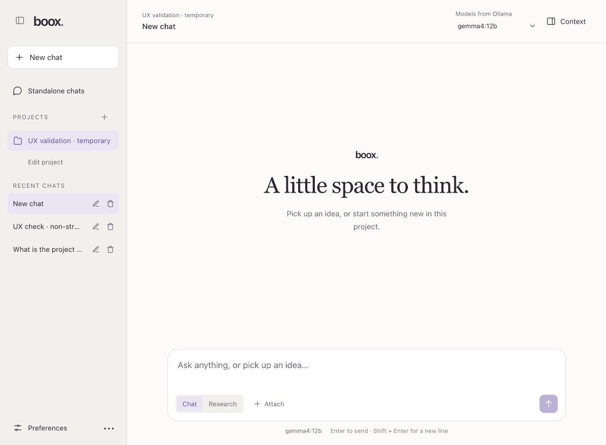

# Quiet conversation UI validation

18 October 2026. Tested the React frontend against the existing local Spring Boot installation using a synthetic project named **UX validation · temporary**. Existing conversations and saved global preferences were preserved. Synthetic project records remain available locally for inspection; fixture pages and upload files are not part of the shipped app.

## Live browser checks

| Area | Result |
| --- | --- |
| Navigation | Desktop sidebar, compact drawer, project destinations, inherited project context, new chat, conversation switching, and inline rename work. |
| Streaming chat | Qwen 2.5 14B returned the project codeword `AMBER FINCH` using the new project's instructions. Context used reported the supplied project and preferences. |
| Conversation restoration | Reload restored the transcript, project, model, and saved context settings. |
| Project notes | Saved a persisted answer, edited it, pinned it, selected it for the next message, and searched/cleared its filter. The note survived conversation reload. |
| Context and advanced settings | Preference/project opt-outs, conversation instructions, temperature, context size, explicit Save, and the streaming toggle are accessible. Saving a new chat preserves an explicit in-session model choice. |
| Non-streaming chat | A local Gemma 4 12B request returned `NONSTREAM_OK`; the persisted answer was visible after reload. |
| Research attachments | Unsupported PDF fixture produced the supported-type error. CSV upload automatically selected Files only and disabled switching to Chat while files were pending. |
| Files-only research | Qwen returned `5 + 7 + 9 = 21`; actual task steps and attached-file evidence were expandable. |
| Research follow-up | Retained-file follow-up returned `5 + 10 + 9 = 24`. Reload during the task restored its running state and kept sending paused. |
| Research cancellation | Cancel showed checkpoint feedback, then the persisted terminal state `Research · Cancelled`; normal controls became usable again. |
| Retained-file clearing | Clear retained files removed the file names from the next-task composer. |
| Image attachments | Vision-capable Gemma offered image upload, displayed the synthetic PNG preview, and removed it on request. Text-only Qwen exposed the capability explanation. No cloud inference was invoked. |
| Preferences and keyboard | Opened preferences, edited an unsaved draft, closed with Escape, and reopened to verify saved preferences were unchanged. Context and note dialogs contain focus and restore their opener. |
| Responsive and theme | Inspected phone widths 320/375px, an 800px frame, and desktop. Checked both light and actual dark design tokens in a temporary browser fixture, including research and the Context drawer. |

## Issues found and corrected

- Saved-message database IDs could collide with draft-message array indexes during a follow-up. Rendering now uses separate key prefixes; the regression test holds a stream open to exercise the live transition.
- Saving settings for a new conversation could replace an explicitly chosen model with the newly created summary's default model. Explicit selections now take priority for their connection during that chat session. Verified with a live save after selecting Qwen.
- New unsaved conversations returned an expected history 404 that was logged as an application error. That normal empty-history case no longer logs an error; unexpected failures still do.
- Saved-note search had an unexplained blank result. It now shows a no-matches message and restores results when the query is cleared.
- The note editor still said Project memory while navigation said Project notes. Labels now agree, and the rename input has an accessible name.

## Automated coverage and limits

`npm test -- --coverage` passes 159 tests, including sending, SSE parsing, execution locks/reconnection, research lifecycle, scope and retained attachments, generation configuration, project/preferences persistence and conflicts, and destructive-action callbacks against mocked APIs. Coverage exceeds all configured CI thresholds. `npm run build` succeeds; the existing large-bundle warning remains.

Deletion and failure/conflict paths are covered by automated tests rather than destructive operations on the shared local installation. Live external web-search providers, cloud-model inference, and a physical mobile keyboard were not exercised. Dark appearance was tested by applying the app's dark tokens in the fixture, without changing the user's operating-system appearance. These checks are a broad UI regression pass, not a formal accessibility or cross-browser certification.
